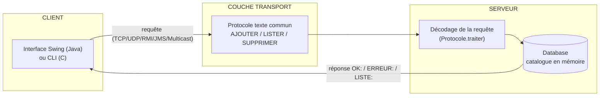

# 🛰️ PolyProto — Application Client-Serveur Multi-Protocoles

> Application de **gestion de produits** (ajouter / lister / supprimer) implémentée
> au-dessus de **6 paradigmes de communication distribuée** différents, en **Java** et en **C**.
> L'objectif est de comparer, sur une même fonctionnalité, le fonctionnement de chaque
> modèle de communication réseau.

<p align="center">
  
  
  
  
</p>

**Auteur :** HAMMAMI Sofiane — Université Abderrahmane Mira, Béjaïa

---

## 📖 Table des matières

- [Présentation](#-présentation)
- [Protocoles & ports](#-protocoles--ports)
- [Architecture](#-architecture)
- [Structure du projet](#-structure-du-projet)
- [Prérequis](#-prérequis)
- [Démarrage rapide](#-démarrage-rapide)
- [Le protocole applicatif](#-le-protocole-applicatif)
- [Détail par protocole](#-détail-par-protocole)
- [Robustesse & validation](#-robustesse--validation)
- [Dépannage](#-dépannage)
- [Limites connues](#-limites-connues)
- [Licence](#-licence)

---

## 🎯 Présentation

Toutes les variantes (TCP, UDP, Multicast, RMI, JMS, RPC) rendent le **même service** :
gérer un catalogue de **produits** `(id, nom, prix)`. Seul le **moyen de transport**
change. Cela permet d'observer concrètement les différences entre :

- communication **fiable** (TCP) vs **non fiable** (UDP) ;
- échange **point-à-point** (TCP/UDP) vs **diffusion de groupe** (Multicast) ;
- **appel de méthode/procédure distante** (RMI, RPC) vs **messagerie asynchrone** (JMS).

Côté Java, le client dispose d'une **interface graphique Swing** ; côté C, d'un
**client en ligne de commande**.

---

## ✨ Protocoles & ports

| Protocole | Java | C | Port Java | Port C | Modèle |
|-----------|:----:|:-:|:---------:|:------:|--------|
| **TCP**       | ✅ | ✅ | `5000` | `6000` | Connecté, fiable, orienté flux |
| **UDP**       | ✅ | ✅ | `5001` | `6001` | Sans connexion, datagrammes |
| **Multicast** | ✅ | ✅ | `230.0.0.1:5002` | `230.0.0.1:6002` | Diffusion 1 → N (notifications) |
| **RMI**       | ✅ | ❌ | `5003` | — | Appel de méthode distante (Java) |
| **JMS**       | ✅ | ❌ | `61616` (ActiveMQ) | — | Messagerie asynchrone (file) |
| **RPC**       | ❌ | ✅ | — | `6003` | Appel de procédure distante (stubs) |

> Les ports Java (`50xx`) et C (`60xx`) sont distincts : les deux implémentations
> peuvent tourner **en même temps** sans conflit.

---

## 🏗️ Architecture

Quel que soit le protocole, on retrouve **trois couches** :



**Points clés de conception :**

- **Modèle partagé** — la classe [`Produit`](common/Produit.java) `(id, nom, prix)` est commune
  à tous les serveurs Java.
- **Logique centralisée** — côté Java, le décodage du protocole texte est factorisé dans une
  seule classe [`Protocole`](server/Protocole.java). Les serveurs TCP, UDP et JMS l'appellent tous,
  ce qui évite la duplication et garantit un comportement identique.
- **Stockage thread-safe** — [`Database`](server/Database.java) synchronise ses opérations
  (`ajouter` / `listerTous` / `supprimer`) pour supporter plusieurs clients TCP simultanés.

---

## 📁 Structure du projet

```
polyproto/
├── build.bat                 # Compile toute la partie Java
├── run.bat                   # Lance un composant Java (classpath géré)
├── .gitignore
│
├── common/
│   └── Produit.java          # Modèle métier partagé (id, nom, prix)
│
├── server/
│   ├── Database.java         # Catalogue en mémoire (thread-safe + validation)
│   ├── Protocole.java        # Décodage centralisé des requêtes texte
│   ├── Server.java           # Serveur TCP (multi-clients via threads)
│   ├── ClientHandler.java    # Thread de traitement d'un client TCP
│   ├── ServerUDP.java        # Serveur UDP
│   ├── ServerMulticast.java  # Émetteur de notifications multicast
│   ├── ProduitService.java   # Interface distante RMI
│   ├── ProduitServiceImpl.java # Implémentation RMI
│   ├── ServerRMI.java        # Registre + publication du service RMI
│   └── ServerJMS.java        # Consommateur de la file ActiveMQ
│
├── client/
│   ├── Client.java           # Client TCP (bas niveau)
│   ├── ClientUDP.java        # Client UDP (avec timeout)
│   ├── ClientMulticast.java  # Récepteur multicast (thread)
│   ├── ClientRMI.java        # Stub client RMI
│   ├── ClientJMS.java        # Producteur de messages JMS
│   └── ClientUI.java         # Interface graphique Swing (point d'entrée)
│
├── c/
│   ├── build.bat             # Compile toute la partie C
│   ├── server_tcp.c / client_tcp.c
│   ├── server_udp.c / client_udp.c
│   ├── server_multicast.c / client_multicast.c
│   └── server_rpc.c / client_rpc.c
│
└── lib/                      # Dépendances JMS (ActiveMQ + Log4j)
    └── activemq-all-5.19.6.jar, log4j-*.jar
```

---

## ⚙️ Prérequis

| Outil | Version | Utilité |
|-------|---------|---------|
| **JDK** | 11+ (testé sur 17) | Compiler/exécuter la partie Java |
| **GCC** | MinGW (Windows) | Compiler la partie C (Winsock) |
| **Apache ActiveMQ** | 5.19.x | **Uniquement** pour le protocole JMS |

> Les bibliothèques ActiveMQ / Log4j nécessaires à la compilation sont déjà fournies
> dans `lib/`. Seul le **broker** ActiveMQ doit être installé séparément pour exécuter JMS.

---

## 🚀 Démarrage rapide

### Java

```bat
:: 1. Compiler (une seule fois, ou après chaque modification)
build.bat

:: 2. Lancer un serveur (dans un terminal)
run.bat server.Server

:: 3. Lancer le client graphique (dans un autre terminal)
run.bat client.ClientUI
```

Le client affiche une fenêtre qui demande le **protocole** (TCP, UDP, RMI ou JMS),
puis propose d'ajouter / lister / supprimer des produits. Les notifications **Multicast**
sont reçues automatiquement en arrière-plan.

### C

```bat
:: 1. Compiler (depuis le dossier c\)
cd c
build.bat

:: 2. Lancer un serveur, puis un client (deux terminaux)
server_tcp.exe
client_tcp.exe
```

---

## 📡 Le protocole applicatif

Tous les transports échangent de simples **lignes de texte**. C'est ce « langage »
commun qui rend les implémentations comparables.

### Requêtes (client → serveur)

| Commande | Format | Exemple |
|----------|--------|---------|
| Ajouter   | `AJOUTER:<nom>:<prix>` | `AJOUTER:Clavier:1500` |
| Lister    | `LISTER`               | `LISTER` |
| Supprimer | `SUPPRIMER:<id>`       | `SUPPRIMER:3` |

> En C/RPC les noms de fonctions sont en minuscules : `ajouter:...`, `lister`, `supprimer:...`.

### Réponses (serveur → client)

| Préfixe | Signification | Exemple |
|---------|---------------|---------|
| `OK:`     | Succès        | `OK:Produit ajouté avec succès` |
| `ERREUR:` | Échec         | `ERREUR:Produit introuvable` |
| `LISTE:`  | Liste de produits (séparés par `;`) | `LISTE:1 \| Clavier \| 1500.0 DA;` |

---

## 🔌 Détail par protocole

<details>
<summary><b>TCP — connexion fiable, multi-clients</b></summary>

Connexion permanente et fiable (orientée flux). Le serveur crée **un thread par client**
([`ClientHandler`](server/ClientHandler.java)), ce qui permet plusieurs clients simultanés.

```bat
:: Java (port 5000)
run.bat server.Server
run.bat client.ClientUI      :: → choisir TCP

:: C (port 6000)
c\server_tcp.exe
c\client_tcp.exe
```
</details>

<details>
<summary><b>UDP — datagrammes sans connexion</b></summary>

Pas de connexion : chaque requête est un datagramme indépendant. Le client applique un
**timeout de 3 s** : si le serveur ne répond pas, il l'indique au lieu de bloquer.

```bat
:: Java (port 5001)
run.bat server.ServerUDP
run.bat client.ClientUI      :: → choisir UDP

:: C (port 6001)
c\server_udp.exe
c\client_udp.exe
```
</details>

<details>
<summary><b>Multicast — diffusion 1 → N</b></summary>

Le serveur émet périodiquement une **notification** vers le groupe `230.0.0.1`.
Tous les clients qui ont rejoint le groupe la reçoivent simultanément. Côté Java,
le client graphique rejoint le groupe automatiquement et affiche les notifications.

```bat
:: Java (groupe 230.0.0.1:5002)
run.bat server.ServerMulticast
run.bat client.ClientUI      :: notifications reçues automatiquement

:: C (groupe 230.0.0.1:6002) — plusieurs clients possibles
c\server_multicast.exe
c\client_multicast.exe
```
</details>

<details>
<summary><b>RMI — appel de méthode distante (Java)</b></summary>

Le serveur publie un objet [`ProduitService`](server/ProduitService.java) dans le registre RMI.
Le client appelle ses méthodes **comme si elles étaient locales** ; RMI gère le réseau et la
sérialisation de façon transparente.

```bat
:: Java (port 5003)
run.bat server.ServerRMI
run.bat client.ClientUI      :: → choisir RMI
```
</details>

<details>
<summary><b>JMS — messagerie asynchrone (ActiveMQ)</b></summary>

Communication **découplée** via un broker : le client **produit** des messages dans la file
`ProduitQueue`, le serveur les **consomme**. Producteur et consommateur n'ont pas besoin
d'être actifs en même temps. **Nécessite qu'ActiveMQ tourne.**

```bat
:: 1. Démarrer le broker ActiveMQ (port 61616)
C:\activemq\bin\activemq.bat start

:: 2. Démarrer le serveur, puis le client
run.bat server.ServerJMS
run.bat client.ClientUI      :: → choisir JMS
```
</details>

<details>
<summary><b>RPC — appel de procédure distante (C)</b></summary>

Implémentation pédagogique de RPC au-dessus de TCP : le client appelle des **stubs**
locaux (`stub_ajouter`, `stub_lister`…) qui masquent l'envoi réseau ; côté serveur, un
**dispatcher** route l'appel vers la bonne procédure.

```bat
:: C (port 6003)
c\server_rpc.exe
c\client_rpc.exe             :: menu interactif
```
</details>

---

## 🛡️ Robustesse & validation

Le serveur ne doit jamais tomber à cause d'une requête fautive. Les protections en place :

- **Requêtes malformées** (argument manquant, prix non numérique, commande inconnue) →
  réponse `ERREUR:...` claire, **sans planter** le serveur ni le thread client.
- **Validation des données** côté serveur ([`Database`](server/Database.java)) : nom obligatoire,
  prix ≥ 0.
- **Validation côté client** ([`ClientUI`](client/ClientUI.java)) : le prix et l'ID sont vérifiés
  avant l'envoi.
- **C — sécurité mémoire** : la construction de la réponse `LISTER` utilise `snprintf` borné,
  ce qui **empêche tout débordement** du buffer même avec un grand catalogue.
- **C — erreurs réseau** : `WSAStartup`, `socket` et `bind` sont contrôlés ; un port déjà
  utilisé produit un message explicite au lieu d'un échec silencieux.

---

## 🆘 Dépannage

| Symptôme | Cause probable | Solution |
|----------|----------------|----------|
| `bind impossible … (déjà utilisé)` / `Address already in use` | Le port est occupé (serveur déjà lancé) | Fermer l'autre instance ou changer le port |
| Client JMS : `Connection refused` | Le broker ActiveMQ n'est pas démarré | `activemq.bat start` avant de lancer JMS |
| `package javax.jms does not exist` | Classpath JMS absent | Compiler via `build.bat` / lancer via `run.bat` |
| Caractères accentués illisibles | Encodage console | Compilé en UTF-8 ; sous `cmd` faire `chcp 65001` |
| Multicast : aucune notification | Pare-feu ou interface réseau | Autoriser Java/l'exe dans le pare-feu Windows |
| `gcc … undefined reference to WSAStartup` | Bibliothèque Winsock non liée | Compiler avec `-lws2_32` (déjà fait par `build.bat`) |

---

## 📌 Limites connues

Choix volontaires pour garder le projet **pédagogique et lisible** :

- **Stockage en mémoire** — le catalogue est perdu à l'arrêt du serveur (pas de base de données).
- **JMS à sens unique** — le client dépose une commande dans la file ; le serveur la traite,
  mais ne renvoie pas de réponse au client (pas de file de retour).
- **C TCP/RPC mono-client** — ces serveurs traitent un client à la fois (pas de threads),
  pour rester simples à lire.
- **Réponse `LISTER` plafonnée** — bornée à la taille du buffer (1024 o) : un très grand
  catalogue est tronqué côté C (mais **jamais** au prix d'un débordement mémoire).

---

## 📝 Licence

Projet réalisé dans un **cadre académique** (Université Abderrahmane Mira, Béjaïa).
Réutilisation libre à des fins d'apprentissage.
